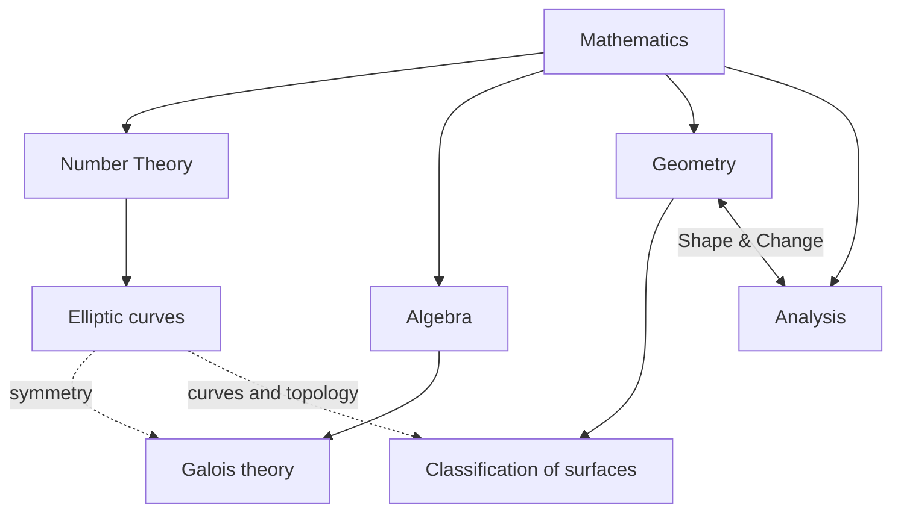

# Math Is Art: platform strategy

7 November 2026 · Working direction

## Thesis

**Math Is Art is a museum and a laboratory for mathematical invention.** The visitor makes a move, sees what survives that move, guesses a rule, and meets the theorem that explains it. The site should make creative thinking visible: choosing a representation, finding an invariant, inventing a useful language, and refining a proof.

Suggested opening line: **Make a move. Find a pattern. Invent a language.**

“Visual sport” means consequential participation. Visitors should be able to try, fail, replay, compare, and explain. Scores and badges are unnecessary; a surprising result is the reward.

## The landscape and what to learn from it

| Reference | Useful lesson | Math Is Art response |
| --- | --- | --- |
| [CrossBoundary](https://crossboundary.com/) | A bold mission, editorial typography, distinct chapters, and a navigable portfolio of specific work | Present mathematical exhibitions as concrete evidence of the thesis; see [design study](crossboundary/DESIGN.md) |
| [Bret Victor: Explorable Explanations](https://worrydream.com/ExplorableExplanations/) | Readers can change a premise and see a consequence immediately | Make the theorem page a responsive argument, not a static essay |
| [Mathigon Polypad](https://mathigon.org/polypad) | Direct manipulation invites mathematical play | Let visitors compose and transform mathematical objects |
| [PhET](https://phet.colorado.edu/en/research) | Simulations use dynamic feedback and are tested with learners | Design each lab around a clear question; test whether visitors can infer the intended relationship |
| [3Blue1Brown](https://www.3blue1brown.com/about) | Visual explanation can make difficult abstractions intuitive | Use short guided sequences before handing control to the visitor |
| [Quantum Country](https://quantum.country/) | An essay can include active recall and gradual learning | Offer optional checks of understanding and a return path to earlier ideas |
| [The Pudding](https://pudding.cool/) | Visual essays in many subjects combine reporting and striking interaction | Treat stories and graphics as one editorial unit |
| [Quanta's Map of Mathematics](https://www.quantamagazine.org/the-map-of-mathematics-20200213/) | A navigable map helps newcomers see connections among branches | Center the *creative moves* behind connections, with experiments and proof paths |

## Editorial map

The homepage is **Mathematics**, followed by **Number Theory**, **Algebra**, **Geometry**, and **Analysis**. Number Theory is the first and most developed destination. Geometry and Analysis remain separate navigation pages with a conspicuous shared path called **Shape & Change**. This preserves the user's conceptual link between them while allowing each to develop its own examples. Elliptic curves live in Number Theory and connect visibly to algebra and geometry.

The thought that “pure math is really number theory” can serve as a curatorial provocation: arithmetic questions draw the branches together. The platform's navigation should still acknowledge the breadth represented in the [Mathematics Subject Classification](https://msc2020.org/). The subjects are entrances, and ideas such as symmetry, invariants, equivalence, and deformation are cross-links.

## First three exhibitions

| Exhibition | Opening challenge | Playable mathematical move | Theorem and depth path |
| --- | --- | --- | --- |
| **Elliptic curves** · Number Theory | “How can one point generate more?” | Choose two points, draw the chord or tangent, see the third intersection and reflection; switch among real shape, rational points, and finite-field counts | Group law, rational points, rank/torsion, LMFDB examples; build exact rational arithmetic into the current atlas |
| **Galois theory** · Algebra | “What can a formula know about its roots?” | Permute roots, keep track of rational relations that survive, and build a field tower | Automorphisms, fixed fields, Galois correspondence; lead through quadratic and cubic examples before the solvability question |
| **Classification of surfaces** · Geometry | “How many fundamentally different closed surfaces are there?” | Glue polygon edges, deform the result, triangulate, count vertices/edges/faces, and test orientability | Classification by orientability and genus for compact connected surfaces, then a clearly marked advanced path toward cobordism |

The surface lab should start with the precise class of surfaces being discussed (closed or with boundary). Cobordism and the h-cobordism theorem need their own assumptions and dimensional qualifications, so they are a later advanced chapter rather than a quick visual conclusion.

Analysis can open with an essay/lab on **flow and shape** (for example heat flow or Fourier decomposition) that links back to the geometry and number theory exhibitions. Choose its first full exhibition after testing the initial three.

## The visitor journey

1. **Provocation:** one visual question and a short, precise invitation.
2. **Move:** the visitor changes an object or condition.
3. **Feedback:** the system shows an immediate consequence and keeps relevant invariants visible.
4. **Conjecture:** the visitor predicts what remains true.
5. **Theorem:** a clean statement appears with its assumptions.
6. **Proof path:** layered explanation, worked example, counterexample, and references.
7. **Return:** an altered challenge asks the visitor to use the idea again.

Every exhibition should work at three depths: a 30-second encounter, a 5–10 minute lab, and a serious theorem/proof/source layer. This is an initial audience assumption: curious adults and students, with optional depth for mathematically experienced readers.

## Homepage and visual direction

1. **Hero:** the thesis in large editorial type, with three small live experiments as the first invitation.
2. **How invention happens:** a short animated/interactive sequence: representation → experiment → invariant → conjecture → proof.
3. **Exhibitions:** three substantial cards, each showing a real mathematical action and an outcome.
4. **Map of ideas:** navigable links across subjects, with Number Theory prominent.
5. **The reading room:** essays, proofs, biographies, source notes, and a bibliography.

Adopt CrossBoundary's clarity of mission and chapter rhythm, then develop a distinct identity from mathematical forms. A preliminary palette could use deep ink, warm paper, a vivid action color, and a separate color for proof annotations. Use generated mathematical vectors and diagrams as hero imagery. Establish final tokens after comparing two or three homepage prototypes and checking contrast, mobile layout, and reduced motion.

## Source and reference library

Each exhibition gets a **source ledger**: theorem statement, assumptions, accessible introduction, primary or authoritative reference, worked examples, image/data rights, and an expert-review note. The first public sources to collect are:

- **Elliptic curves:** [LMFDB elliptic curves over ℚ](https://www.lmfdb.org/EllipticCurve/Q/) for records and examples; [SageMath elliptic curves over ℚ documentation](https://doc.sagemath.org/html/en/reference/arithmetic_curves/sage/schemes/elliptic_curves/ell_rational_field.html) for computational checks. The current atlas is a starting prototype, and its real graph, rational arithmetic, and finite-field views should be labeled distinctly.
- **Galois theory:** [James Milne, *Fields and Galois Theory*](https://www.jmilne.org/math/CourseNotes/FT.pdf) and [MIT OpenCourseWare Algebra II notes](https://ocw.mit.edu/courses/res-18-012-algebra-ii-student-notes-spring-2022/).
- **Surfaces:** [Gallier and Xu, *A Guide to the Classification Theorem for Compact Surfaces*](https://www.cis.upenn.edu/~jean/surfclassif-root.pdf) and [Notre Dame classification notes](https://academicweb.nd.edu/~andyp/notes/ClassificationSurfacesLong.pdf).
- **Advanced cobordism path:** [Milnor, *Lectures on the h-Cobordism Theorem*](https://webhomes.maths.ed.ac.uk/~v1ranick/surgery/hcobord.pdf), used for study and citation, with publication rights checked before reproducing any material.

Publicly accessible sources are enough for the first content architecture and prototypes. User-supplied books or scans can deepen an exhibition: provide the edition and relevant pages, and we can extract the mathematical ideas into original prose, proofs, and diagrams with attribution. The site should link or cite sources while publishing original explanations and visuals.

## Hermes skills and production workflow

The relevant local skills at `C:\Users\JasonOyugi\AppData\Local\hermes\skills` are:

| Skill | Planned use |
| --- | --- |
| `frontend-design` | Develop the platform's identity, hierarchy, motion, and component quality |
| `creative/design-md` | Record final design tokens and principles in a maintained `DESIGN.md` |
| `creative/sketch` | Compare two or three disposable homepage/interaction directions |
| `creative/p5js` | Prototype direct manipulation and mathematical canvases |
| `creative/manim-video` | Produce short authored explanatory sequences where motion clarifies a construction |
| `creative/excalidraw` | Map navigation and proof/interaction flows |
| `research/grounded-citations` and `arxiv-search` | Maintain the source ledger and find accessible research references |

Use the existing Sites project for rapid web iteration, then sync reviewed source to the local `Math-Is-Art/elliptic curves` repository folder. The eventual platform can grow beyond that folder once the umbrella architecture is approved.

## Build order and review gates

1. **Concept sprint:** two or three homepage sketches, one design system draft, and a tested navigation model.
2. **Foundation:** Mathematics homepage, subject landing pages, source ledger, accessible interaction shell, responsive layouts.
3. **Number Theory exhibition:** migrate and strengthen the elliptic atlas, with exact rational calculations and clear ℝ/ℚ/𝔽ₚ distinctions.
4. **Algebra exhibition:** Galois root-permutation lab and guided proof path.
5. **Geometry exhibition:** surface gluing and classification lab; add the advanced cobordism chapter after mathematical review.
6. **Analysis bridge:** choose a full treatment based on what users find most illuminating in the first three.

Before publishing each exhibition, verify the theorem statement and hypotheses, numerical examples, keyboard/touch behavior, reduced-motion behavior, and whether a learner can articulate the intended insight. A mathematician should review the advanced claims.

## Immediate deliverable

Start with a clickable homepage concept and one polished elliptic-curve journey from an intuitive move to a precise group-law statement. Use it to test the platform's central claim: visitors should leave able to describe a mathematical idea they helped discover.
